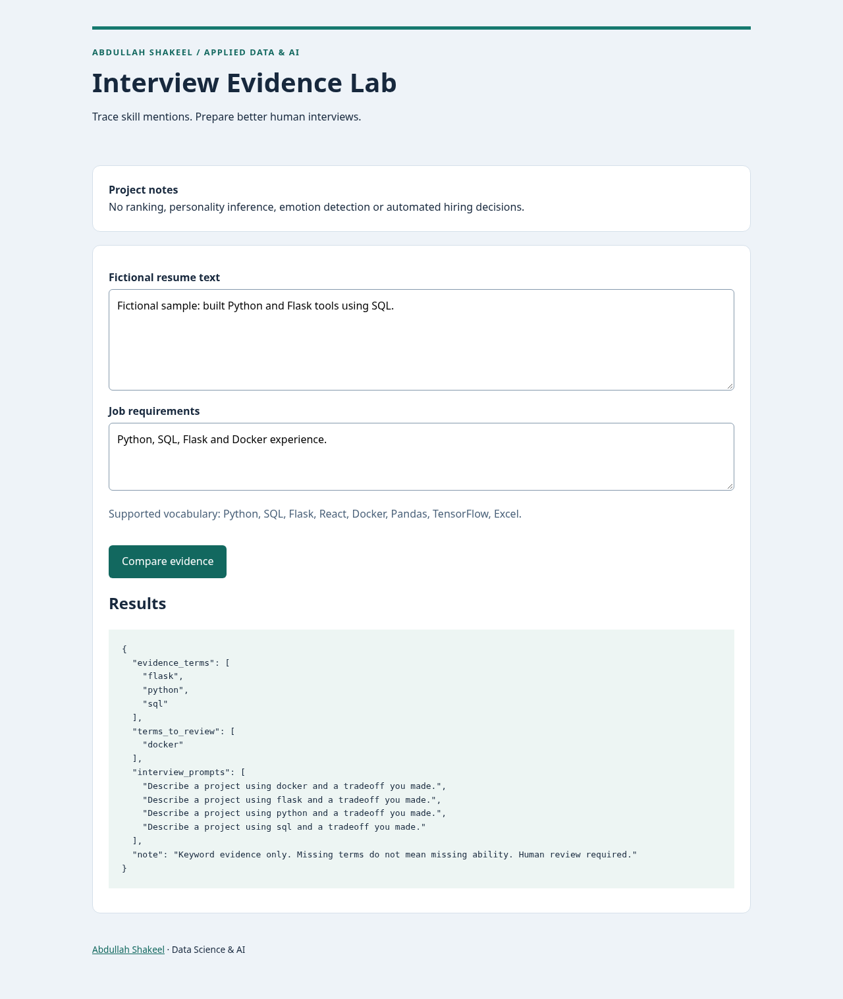

# Interview Evidence Lab

I use explicit skill evidence to help a human reviewer compare resume text with job requirements and prepare consistent interview questions.

**Portfolio project · Abdullah Shakeel**

Python application with reproducible setup, tests and evaluation. See [provenance and scope](PROVENANCE.md) for the implementation background.



## Problem and intended users

Recruiters and applicants reviewing fictional text samples.

## Features and architecture

Case-insensitive skill extraction with word boundaries; explicit matched and missing terms; reproducible interview prompts; escaped HTML; document length limits.

```text
Flask form → input validation → boundary-aware skill extraction → set comparison → JSON evidence and question prompts.
```

Python and Flask keep the implementation inspectable and local. The tiny explicit vocabulary makes its behavior auditable; a generative model is unnecessary for this task.

## Run locally

Requires Python 3.12. From this repository directory:

```bash
python -m venv .venv
# Windows PowerShell: .venv\Scripts\Activate.ps1
. .venv/bin/activate
pip install -r requirements.txt
python app.py
```

Open http://127.0.0.1:5001 and submit the included fictional example. No credentials or external services are required. `.env.example` documents configuration, but Flask entry points use the documented fixed ports and do not load a .env file. Development servers bind to localhost. They are not production deployments.

## Validate and reproduce evaluation

```bash
pip install -r requirements-dev.txt
python -m pytest -q
python evaluate.py
```

`artifacts/evaluation.json` records the actual preparation run. Read its method alongside every metric. CI runs Python checks and evaluation on push/PR; GitHub Actions validates the application on push and pull requests. Actual desktop and mobile-width browser screenshots are in `artifacts/`. Those screenshots show the Python web interface, not a mobile binary.

## Data and provenance

All example text and evaluation cases are authored for this implementation; no applicant records are included.

See [PROVENANCE.md](PROVENANCE.md) and [LICENSE-REVIEW.md](LICENSE-REVIEW.md). Newly authored source and fixtures use MIT; dependencies retain their own licenses. No CV numerical achievement is represented as a measured result.

## Limitations and responsible use

This is not a trained job-fit predictor, PDF resume parser or candidate ranking system. A mention may be negated, copied or unsupported by experience. Missing vocabulary and alternate spellings cause omissions. No personality, video emotion or protected-trait inference is performed. Do not use this system to automate hiring.

Inputs are processed in memory; application code does not persist form contents. Standard web-server request metadata may still appear in local logs. Use fictional examples, never confidential employer, applicant, patient or billing information. No authentication or production abuse protection is included; keep this demo local.

## Future improvements

Add attributed, consented fictional resume fixtures, structured evidence spans, PDF text extraction with resource limits, synonym handling and accessibility-reviewed human workflows. Validate across resume formats and languages before broader use.

## Repository guide

- `core.py`: data/model or matching logic.
- `app.py`, `templates/`: local web interface.
- `evaluate.py`: reproducible evaluation and method.
- `test_app.py`: functional and boundary validation.
- `.github/workflows/validate.yml`: Python CI definition.
- `artifacts/`: actual results and screenshots.

## Project summary

Built a Flask prototype that extracts explicit skill evidence from fictional resumes and job descriptions and generates consistent interview prompts, with input validation and tests.
